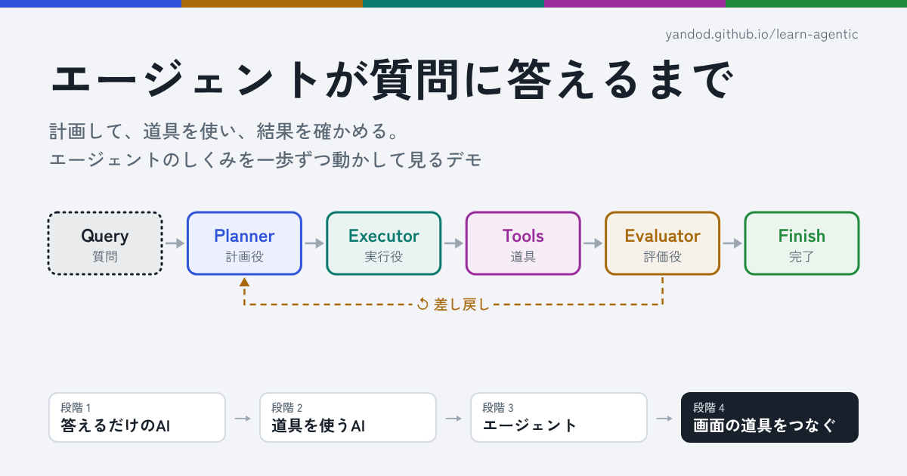

# エージェントが質問に答えるまで

答えるだけの AI から、道具を使う AI、そしてエージェントへ。計画・点検・実行・確認の流れを、4 つの段階で一歩ずつ動かして見るデモです。

公開ページ: https://yandod.github.io/learn-agentic/ （[English](https://yandod.github.io/learn-agentic/en/) / [한국어](https://yandod.github.io/learn-agentic/ko/)）



## 4 つの段階

| 段階 | 内容 |
| --- | --- |
| 1. 答えるだけの AI | 質問を受け取り、学習した知識だけで答えの文を作る |
| 2. 道具を使う AI | 道具（Web 検索と画像生成）を 1 回呼び、その出力を読んでから答える |
| 3. エージェント | 道具を何度も使う質問で、計画を立て、点検し、実行し、結果を確かめる |
| 4. 画面の道具をつなぐ | 段階 3 と同じ形のまま、道具を作業台のブラウザ・電卓・ドット絵キャンバスに入れ替える。道具を呼ぶと作業台が実際に動く |

モデルの呼び出しはすべてページ内の台本で再現しています。API キーやサーバーは要りません。

## ファイル構成

```
index.html          日本語のページ（これが元。文言は 3 言語ぶんここに入っている）
en/index.html       英語のページ（生成物）
ko/index.html       韓国語のページ（生成物）
og/{ja,en,ko}.png   SNS 用のサムネイル（生成物）
tools/site.mjs      公開 URL と、言語ごとの題名・説明・サムネイルの文言
tools/build.mjs     index.html から en/ と ko/ を作り、<head> のメタ情報を書き直す
tools/og-image.mjs  サムネイルを作る
```

## 手元で見る

ビルドなしで動きます。`index.html` をブラウザで開くか、静的サーバーを立てます。

```sh
python3 -m http.server
# http://localhost:8000/ を開く
```

## 直すとき

`en/index.html` と `ko/index.html` は直接直さないでください。`index.html` を直してから、次を実行します（Node.js 22 で確認）。

```sh
node tools/build.mjs
```

GitHub Actions（`.github/workflows/pages-in-sync.yml`）が push と pull request のたびに同じコマンドを実行し、`en/` と `ko/` が作り直されていなければ失敗します。

ページの題名・説明・SNS 用のメタ情報は `tools/site.mjs` にあります。題名は `index.html` の `I18N[..].ui.title` とそろえてください。

### サムネイルを作り直す

`tools/site.mjs` の文言を変えたら、サムネイルも作り直します。Playwright（Chromium）が要ります。

```sh
npm install playwright
npx playwright install chromium
node tools/og-image.mjs
```

手元の Chromium を使う場合は `CHROMIUM_PATH` にパスを渡します。文字が枠からはみ出すと、エラーで止まります。
